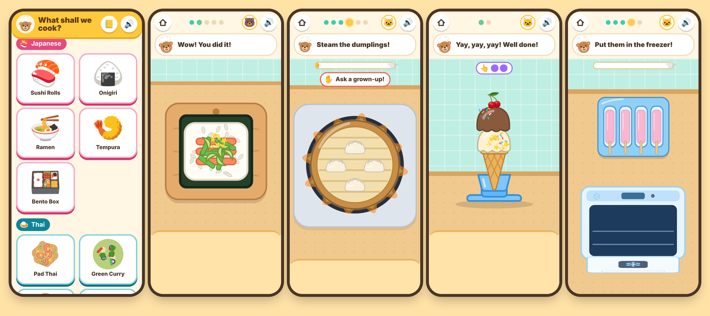

# Kids Kitchen

A tap-to-cook game for little chefs aged 3–7. An animal friend is hungry: pick a dish, wash your
hands, tap the raw ingredients into the bowl, stir, chop, cook on the stove, bake in the oven — then
feed your friend and collect a sticker.



No reading needed: the chef says every instruction out loud and a pointing hand shows what to do
if a child gets stuck. Nothing can really go wrong — the worst that happens is a burger that is
"a little bit crispy".

## The 56 dishes

| Breakfast | Lunch | Dinner | Treats |
| --- | --- | --- | --- |
| Pancakes | PB & J | Cheeseburger | Chocolate Chip Cookies |
| Waffles | Grilled Cheese | French Fries | Cupcakes |
| Bacon & Eggs | Hot Dog | Pizza | Apple Pie |
| | Mac & Cheese | Spaghetti & Meatballs | Ice Cream Cone |
| | Chicken Noodle Soup | Tacos | Ice Pops |
| | Garden Salad | Chicken Nuggets | Strawberry Milkshake |
| | | Corn on the Cob | Donuts |
| | | Baked Potato | Brownies |

| Tex-Mex | Cajun & Creole | Filipino |
| --- | --- | --- |
| Quesadilla | Crawfish Étouffée | Lumpia |
| Nachos | Crawfish Boil | Sopas |
| Cheese Enchiladas | Gumbo | Sinigang |
| Fajitas | Jambalaya | Chicken Adobo |
| Chili | Beignets | Pancit |
| | | Halo-Halo |

| Japanese | Thai | Chinese |
| --- | --- | --- |
| Sushi Rolls | Pad Thai | Dumplings |
| Onigiri | Green Curry | Fried Rice |
| Ramen | Tom Yum Soup | Chow Mein |
| Tempura | Chicken Satay | Sweet & Sour Chicken |
| Bento Box | Mango Sticky Rice | Egg Drop Soup |

The Cajun & Creole dishes come from the Breaux Bridge area of Louisiana (the "crawfish capital of the
world"); the Filipino dishes are family favourites of the Filipino community in Sacramento.

## How to play

Everything is one tap — no dragging, no swiping.

- **Wash hands:** every recipe starts at the sink — tap the soap, then the water.
- **Add:** tap an ingredient and it hops into the bowl, pot, pan, tray or plate.
- **Choose:** some dishes let the child decide — pizza toppings, cupcake and donut frosting, ice cream
  scoops, waffle, burger, baked potato and nacho toppings. The tiles with a dashed purple border are
  the choices.
- **Stir / roll:** tap, tap, tap the spoon or rolling pin (or the bowl).
- **Chop:** tap, tap, tap the knife (or the food).
- **Cook:** tap the 🔥 to turn on the stove, tap the spatula to flip, and tap the crossed-out 🔥 to
  turn the heat off when the food is ready. Left on too long, it gets a little crispy (or the pot
  bubbles over) — and the game carries on.
- **Bake:** tap the tray and it slides into the oven; tap the oven to take it out when it dings.
- **Steam / freeze:** dumplings cook in a bamboo steamer, and ice pops go into the freezer the same
  way a tray goes into the oven (nothing can burn in there).
- **Feed your friend:** tap the finished dish and the friend gobbles it up.

The chef also reminds children that a grown-up helps with the stove, the oven and knives.

## Friends, stickers and badges

- **Friends:** an animal friend comes to eat every dish. One of them is always waiting in the cookbook
  with an order ("Bunny wants Pizza!"); cooking it earns two hearts instead of one. Four friends are
  there from the start and twelve more arrive as more different dishes are cooked.
- **Sticker book** (📒): one sticker per dish, the friends and their hearts, and sixteen badges
  (first dish, 5, 10, 20 and 40 dishes, every dish, and one for finishing each cookbook section).

## For grown-ups

"For grown-ups" on the title screen opens after pressing a button for three seconds. There you can:

- turn the chef's voice, the sound effects and the music on or off separately, and test each one;
- turn off hand washing, the "ask a grown-up" reminders, or food getting crispy (the heat then turns
  off by itself — good for the youngest cooks);
- hide cookbook sections;
- see whether the game is saved for playing without internet;
- erase stars, stickers and friends.

Everything is kept on the device. There are no accounts, ads, purchases or tracking.

## Playing without internet

The first time the game is opened it saves itself and the chef's recordings (about 5 MB) on the device.
After that it works with no connection — in the car, on a plane — including from the Home Screen.
When there is a connection, the newest version is loaded automatically. (`sw.js` does this;
`tools/check.js` makes sure every file the page loads is on its list.)

## Play it on an iPhone

The layout is tuned for the iPhone 16 (393 × 852 pt, portrait) and respects the Dynamic Island
and home-indicator safe areas. For a full-screen, app-like game: open the site in Safari →
Share → **Add to Home Screen**.

Sound plays even when the phone's ring/silent switch is on silent; use the 🔊 button in the game to mute.

Adding it to the Home Screen is also the safest way to keep progress: Safari can clear the saved data of
web pages that have not been opened for a while, but it leaves Home Screen apps alone. The Home Screen
app keeps its own stars and stickers, separate from the Safari tab.

Tapping the chef's picture in the cookbook goes back to the title screen (sticker book, grown-ups).

## Publishing (GitHub Pages)

The site is plain static files, so GitHub Pages serves it straight from the repository:
**Settings → Pages → Source: Deploy from a branch → `main` / `(root)`**. Every push to `main`
republishes it a minute or so later. `.github/workflows/check.yml` only checks the files.

## Run it locally

It is a plain static site with no build step and no dependencies:

```sh
python3 -m http.server 8000
# then open http://localhost:8000
```

## The chef's voice, the sounds and the music

- **Voice:** every line the chef says is a small recording in `assets/voice/`, made ahead of time with
  [Kokoro](https://github.com/hexgrad/kokoro) (an open, Apache-2.0 text-to-speech model) using a warm,
  upbeat, slightly slowed-down voice in the style of a preschool teacher. It is a synthetic voice, not a
  recording or imitation of any real person. If a recording is missing, the phone's own voice reads the line.
- **Changing what the chef says:** edit `js/lines.js`, the `say:` lines in `js/recipes.js`, the names in
  `js/art.js` or the friends in `js/store.js`, then run `tools/make-voice.py` (instructions at the top of
  that file) to record the new lines.
- **Sound effects** (sizzling, boiling, the oven, chopping, pouring, egg cracks, crunching, slurping,
  applause and more) and the quiet **background music** are generated in the browser by `js/audio.js` —
  there are no sound files. The music turns itself down while the chef is talking.

## Adding a dish

Recipes are data in `js/recipes.js` — a list of steps (`add`, `rub`, `chop`, `cook`, `bake`, `eat`).
Pictures live in `js/art.js` (inline SVG and emoji, no image files). The game engine is `js/game.js`,
sounds, music and the talking chef are `js/audio.js`, saved progress, friends and badges are
`js/store.js`, and the sticker book and grown-ups' corner are `js/screens.js`. Give a recipe `sp:`
(how the chef says its name) and, if you like, `eat:` (`crunch`, `slurp` or `munch`). To let the child
choose, mark the choices with `opt: true` and give the step `pick: N`. Run `node tools/check.js`
afterwards.
